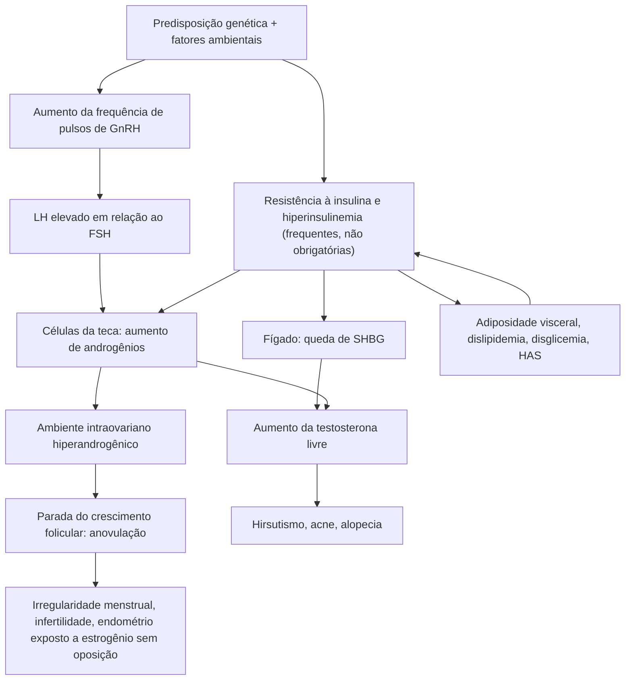
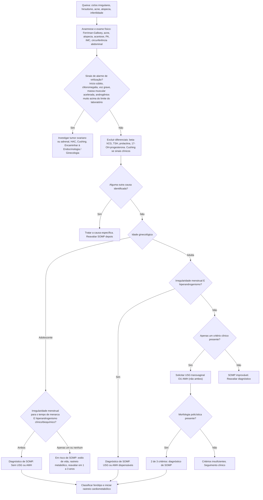
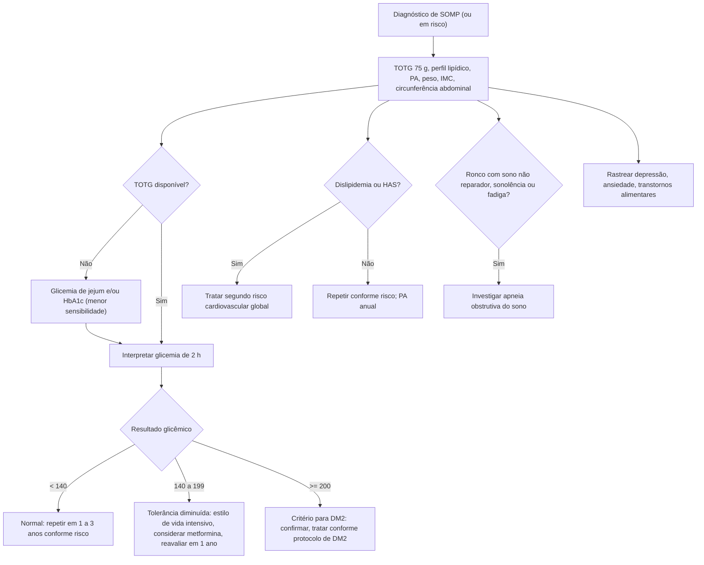
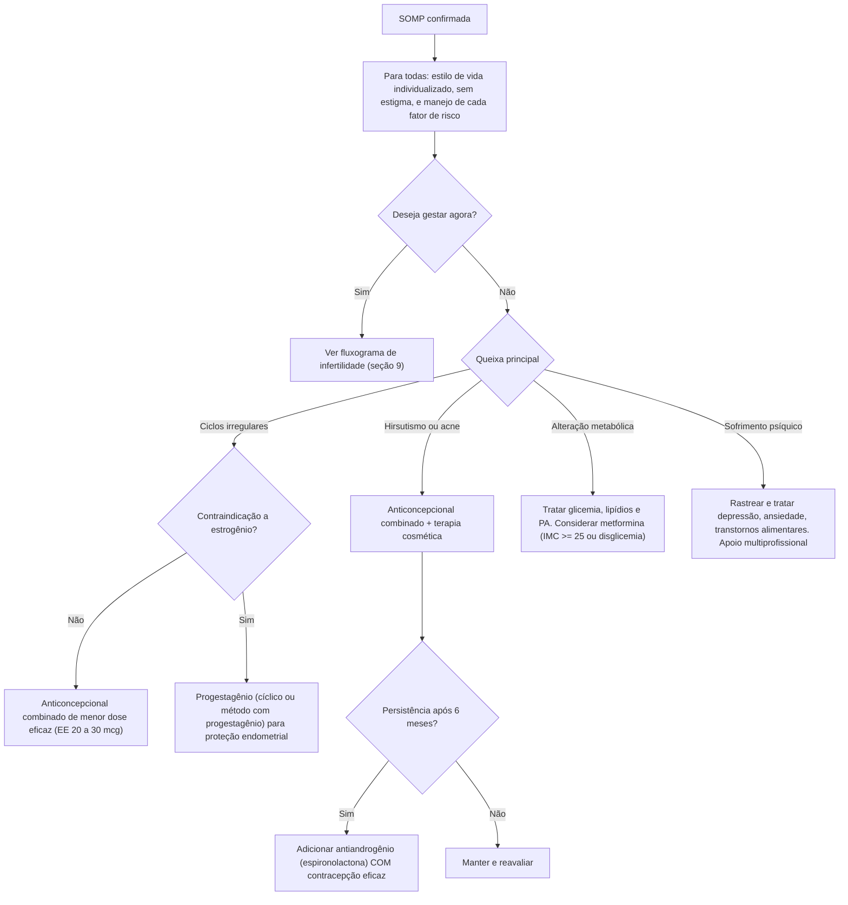
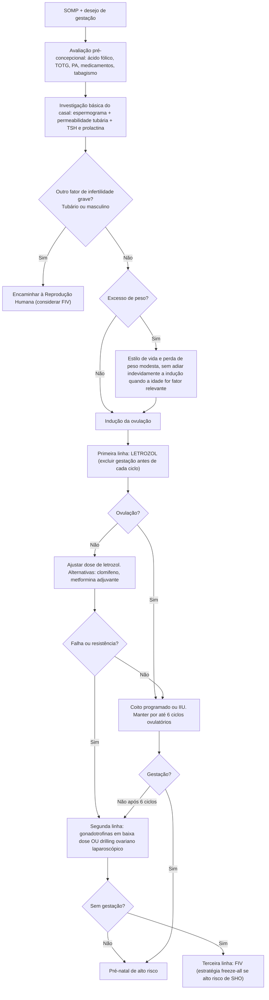
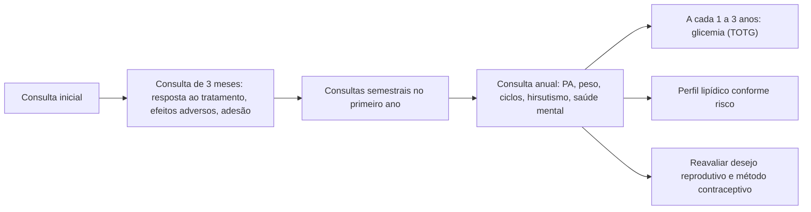

Em maio de 2026, a **Síndrome dos Ovários Policísticos (SOP/PCOS)** foi renomeada por consenso global para **Síndrome Ovariana Metabólica Poliendócrina (SOMP/PMOS)**.

| Limitação do termo antigo | Correção proposta |
| --- | --- |
| Sugere doença restrita aos ovários | Condição multissistêmica (reprodutiva, endócrina, metabólica, dermatológica e psicossocial) |
| Ignora o componente metabólico | Metabolismo e endocrinologia são centrais para o cuidado longitudinal |
| "Cistos" não existem: são folículos em diferentes estágios | Achado ovariano é apenas um dos critérios e nem sempre está presente |

> **Transição:** os critérios diagnósticos e as recomendações da Diretriz Internacional de 2023 **permanecem válidos**. FEBRASGO 2025 e PCDT brasileiro ainda usam "SOP". Neste protocolo, **SOMP** é o termo principal e **SOP** aparece apenas como nomenclatura histórica. Prontuários, CID e documentos do SUS podem usar SOP durante a transição.

---

A SOMP é crônica, heterogênea e multifatorial. Afeta cerca de 10% das mulheres em idade reprodutiva e é a principal causa de hiperandrogenismo e de infertilidade anovulatória.

O raciocínio clínico deve integrar **quatro eixos**:

1. **Reprodutivo:** irregularidade menstrual, anovulação, infertilidade.
2. **Hiperandrogênico:** hirsutismo, acne, alopecia de padrão feminino.
3. **Metabólico:** resistência à insulina, pré-diabetes, DM2, dislipidemia, hipertensão.
4. **Psicológico e qualidade de vida:** depressão, ansiedade, transtornos alimentares, estigma corporal, impacto sexual.

**Mensagens centrais:**

- Resistência à insulina é frequente, mas **não é obrigatória nem critério diagnóstico**.
- O risco metabólico existe também em mulheres com **IMC normal**. O rastreio não deve se restringir a quem tem sobrepeso ou obesidade.
- Não solicitar insulina de jejum ou índices (HOMA-IR) como teste diagnóstico de rotina.
- Relação LH/FSH > 2 é comum, mas **não é critério diagnóstico**.
- Acantose nigricans sugere hiperinsulinemia, **não é sinal de hiperandrogenismo** e não é patognomônica.

---

## Fisiopatologia resumida

---

## Diagnóstico

**O diagnóstico é de exclusão.** Aplicar o modelo de Rotterdam atualizado pela Diretriz Internacional de 2023.

### Critérios em adultas: 2 de 3, após excluir outras causas

| Critério | Como caracterizar |
| --- | --- |
| **1. Disfunção ovulatória** | Ciclos irregulares, oligo-ovulação ou anovulação |
| **2. Hiperandrogenismo clínico e/ou bioquímico** | Hirsutismo (Ferriman-Gallwey modificado) ou androgênios elevados em ensaio confiável. Acne e alopecia isoladas são menos específicas |
| **3. Morfologia ovariana policística** | Ultrassonografia (USG) transvaginal **ou** hormônio anti-Mülleriano (AMH) em algoritmo validado |

**Regras práticas:**

- Irregularidade menstrual **+** hiperandrogenismo: **USG e AMH não são necessários** para fechar o diagnóstico.
- Não solicitar AMH e USG simultaneamente apenas para aumentar a chance diagnóstica.
- Ciclos "regulares" não excluem anovulação, mas tornam a SOMP como explicação principal menos provável.

### Definição de irregularidade menstrual

Após a transição puberal inicial, avaliar quando houver:

| Tempo após a menarca | Padrão que exige avaliação |
| --- | --- |
| 1 a menos de 3 anos | Ciclos < 21 dias ou > 45 dias |
| 3 anos ou mais | Ciclos < 21 dias ou > 35 dias, ou < 8 ciclos por ano |
| Mais de 1 ano | Qualquer ciclo > 90 dias |
| Amenorreia primária | Ausência de menarca aos 15 anos ou mais, ou mais de 3 anos após a telarca |

### Ultrassonografia (adultas)

Com equipamento moderno e via **transvaginal**, considera-se morfologia policística quando houver:

- **≥ 20 folículos por ovário** (2 a 9 mm) em pelo menos um ovário; **ou**
- **volume ovariano ≥ 10 mL**.

Se a qualidade da imagem não permitir contagem completa: volume ≥ 10 mL ou ≥ 10 folículos por corte. Desconsiderar folículo dominante, corpo lúteo e cisto relevante no cálculo do volume.

> **Atenção:** o corte antigo de **≥ 12 folículos** (Rotterdam 2003) **não deve ser usado** com equipamento moderno. Ele ainda aparece em provas e materiais antigos.
> Ovários multifoliculares isolados, sem clínica, **não fecham** o diagnóstico.

### Adolescentes

| Item | Conduta |
| --- | --- |
| Critérios | **Ambos, simultaneamente:** irregularidade menstrual (conforme tempo de menarca) **e** hiperandrogenismo clínico e/ou bioquímico, após excluir diferenciais |
| USG e AMH | **Não usar para diagnóstico** (morfologia multifolicular e AMH alto fazem parte do desenvolvimento normal) |
| Apenas um critério | Classificar como **"em risco de SOMP"**, orientar estilo de vida e reavaliar periodicamente |
| Reavaliação | Revisar o diagnóstico, em geral, cerca de 8 anos após a menarca |

### Fluxograma diagnóstico

### Fenótipos de Rotterdam

| Fenótipo | Hiperandrogenismo | Disfunção ovulatória | Morfologia ovariana policística |
| --- | --- | --- | --- |
| **A** (clássico completo) | Sim | Sim | Sim |
| **B** (clássico sem morfologia ovariana) | Sim | Sim | Não |
| **C** (ovulatório) | Sim | Não | Sim |
| **D** (não hiperandrogênico) | Não | Sim | Sim |

O risco metabólico varia **dentro de cada fenótipo** e depende de idade, adiposidade, histórico familiar, etnia, PA, perfil lipídico e glicêmico. **Não classificar um fenótipo automaticamente como "baixo risco".** Um USG normal não exclui o fenótipo B.

---

## Avaliação do hiperandrogenismo

### Clínico

- **Hirsutismo:** escore de Ferriman-Gallwey modificado. O ponto de corte depende de etnia e população; a diretriz admite valores aproximados entre **4 e 6**, e não um corte universal de 8. Provas antigas podem usar ≥ 8.
- Acne e alopecia isoladas: menor especificidade.

### Bioquímico

- Priorizar **testosterona total e livre** ou **índice de androgênios livres**, com método laboratorial confiável.
- Anticoncepcional combinado altera SHBG e androgênios. Se a dosagem for indispensável, suspender por **pelo menos 3 meses**, com contracepção alternativa não hormonal.
- Hirsutismo evidente já cumpre o critério clínico. A dosagem ajuda quando a apresentação é duvidosa.

### Sinais de alarme (afastar outras causas)

Virilização rápida, clitoromegalia, voz grave, aumento acelerado de massa muscular ou androgênios muito acima do limite do laboratório. Considerar tumor ovariano ou adrenal, hiperplasia adrenal congênita, Cushing e outras causas de hiperandrogenismo grave. **Não depender de um único valor fixo de testosterona** para essa decisão (o corte de 200 ng/dL citado em materiais didáticos é apenas referência de apoio).

---

## Diagnósticos diferenciais e exames de exclusão

| Diagnóstico diferencial | Exame / abordagem | Observação |
| --- | --- | --- |
| Gestação | beta-hCG | Sempre antes de investigar amenorreia |
| Disfunção tireoidiana | TSH | Hipo e hipertireoidismo alteram o ciclo |
| Hiperprolactinemia | Prolactina | Inibe o GnRH e causa anovulação |
| HAC não clássica | 17-OH-progesterona (fase folicular, manhã) | Valores > 200 ng/dL (2 ng/mL) exigem investigação adicional. Valores muito altos (> 1.000 ng/dL) praticamente confirmam o diagnóstico |
| Síndrome de Cushing | Testes específicos se houver sinais clínicos | Fácies em lua cheia, estrias violáceas, obesidade centrípeta, fraqueza proximal |
| Tumores produtores de androgênios | Androgênios, imagem | Início súbito, progressão rápida, virilização |
| Amenorreia hipotalâmica funcional | História (peso, esforço, estresse), gonadotrofinas | LH e FSH baixos |
| Insuficiência ovariana primária | FSH, estradiol | Considerar em amenorreia com FSH elevado |
| Medicamentos | Revisar uso | Alteram ciclos ou androgênios |

---

## Rastreamento cardiometabólico

O objetivo é **identificar e tratar cada fator de risco modificável**, e não apenas rotular "síndrome metabólica".

### Esquema de rastreio

| Parâmetro | Quando | Como |
| --- | --- | --- |
| **Glicemia** | No diagnóstico, em **todas** (adultas e adolescentes), qualquer IMC | **TOTG 75 g** (mais acurado). Se inviável: glicemia de jejum e/ou HbA1c (menor sensibilidade) |
| Repetição glicêmica | A cada **1 a 3 anos** | Conforme idade, adiposidade, histórico familiar e alteração prévia |
| **Perfil lipídico** | No diagnóstico, independentemente de idade e IMC | Repetir conforme resultado e risco cardiovascular global |
| **Pressão arterial** | **Anual** e no planejamento reprodutivo | Medida correta, com manguito adequado |
| Peso, IMC, circunferência abdominal | Em toda consulta | Avaliar sem estigma |
| Apneia obstrutiva do sono | Investigar se ronco + sono não reparador, sonolência ou fadiga | Independe do IMC |
| Saúde mental | No diagnóstico e no seguimento | Depressão, ansiedade, transtornos alimentares, qualidade de vida |

**Gestação ou tratamento de fertilidade:** considerar TOTG no planejamento. Se não realizado antes, oferecer na primeira consulta pré-natal e novamente entre **24 e 28 semanas**.

### Interpretação do TOTG 75 g (glicemia 2 h)

| Resultado | Interpretação |
| --- | --- |
| < 140 mg/dL | Tolerância normal |
| 140 a 199 mg/dL | Tolerância diminuída à glicose |
| ≥ 200 mg/dL | Critério para diabetes (confirmar quando não houver hiperglicemia inequívoca) |

### Síndrome metabólica (NCEP-ATP III): 3 de 5 componentes

| Componente | Corte clássico (mulheres) |
| --- | --- |
| Circunferência abdominal | > 88 cm (ajustar conforme população e diretriz adotada) |
| Triglicerídeos | ≥ 150 mg/dL ou em tratamento |
| HDL-colesterol | < 50 mg/dL ou em tratamento |
| Pressão arterial | ≥ 130/85 mmHg ou em tratamento |
| Glicemia de jejum | ≥ 100 mg/dL ou em tratamento |

O IMC não compõe formalmente esses critérios, mas permanece relevante na avaliação clínica.

### Fluxograma de rastreio e seguimento cardiometabólico

---

## Tratamento orientado por objetivos

O tratamento deve considerar **sintoma prioritário, desejo reprodutivo, risco metabólico, contraindicações, preferências e impacto psicossocial.**

### Fluxograma de decisão terapêutica

### Estilo de vida (primeira linha para todas)

Há benefício **mesmo sem perda de peso**. A intervenção deve ser sustentável, culturalmente adequada e livre de estigma.

| Domínio | Orientação |
| --- | --- |
| Atividade aeróbica | 150 a 300 min/semana moderada **ou** 75 a 150 min/semana vigorosa |
| Fortalecimento muscular | Em 2 dias não consecutivos por semana |
| Alimentação | Equilibrada, factível e culturalmente adequada. **Não há dieta única superior** |
| Peso | Prevenir ganho excessivo. Se houver excesso de peso, perdas modestas melhoram parâmetros metabólicos, ciclos e ovulação. Evitar promessas fixas (ex.: "5% restaura a ovulação") |
| Outros | Sono, saúde mental, redução do sedentarismo, cessação do tabagismo |

Iniciar em nível possível e progredir conforme capacidade, preferências e comorbidades.

### Irregularidade menstrual e hiperandrogenismo (sem desejo de gestação)

**Anticoncepcional combinado (ACO)** é a primeira linha farmacológica, se não houver contraindicação (seguir critérios de elegibilidade contraceptiva da OMS).

- Nenhuma formulação é universalmente superior.
- Preferir a **menor dose eficaz de estrogênio**: 20 a 30 mcg de etinilestradiol ou equivalente.
- **EE 35 mcg + acetato de ciproterona:** segunda linha, pelo maior risco de eventos adversos, incluindo tromboembolismo venoso.
- Progestagênios com efeito antiandrogênico (drospirenona, dienogeste, ciproterona) podem ser considerados, respeitando o perfil de risco.

**Antiandrogênio (espironolactona):**

- Considerar se hirsutismo persistir após **pelo menos 6 meses** de ACO e/ou terapia cosmética.
- Dose usual em materiais nacionais: 100 a 200 mg/dia, individualizar.
- **Contracepção eficaz obrigatória** (risco de feminização de feto masculino).
- Monitorar potássio e PA conforme o contexto clínico.

**Proteção endometrial** (quem permanece longos períodos sem menstruar): ACO, progestagênio cíclico ou método com progestagênio (ex.: SIU de levonorgestrel). O risco relativo de hiperplasia e câncer endometrial é maior, mas o **risco absoluto é baixo**. **Não** se recomenda rastreio ultrassonográfico rotineiro em assintomáticas. Sangramento uterino anormal exige investigação.

### Metformina

- Indicação principal: **desfechos metabólicos** (glicemia, resistência à insulina, perfil lipídico), em especial em adultas com **IMC ≥ 25 kg/m²** ou disglicemia.
- **Não é obrigatória** para todas e **não é primeira linha isolada** para hirsutismo, perda de peso ou indução de ovulação.
- Iniciar com dose baixa e aumentar **500 mg a cada 1 ou 2 semanas** (faixa habitual de 1.500 a 2.000 mg/dia). Efeitos gastrointestinais são frequentes e dose-dependentes. Formulação de liberação prolongada pode melhorar a tolerância.
- Uso prolongado pode reduzir vitamina B12: considerar monitorização em quem tem fatores de risco.

### Resumo terapêutico

| Objetivo principal | Estratégia preferencial |
| --- | --- |
| Saúde global e risco cardiometabólico | Estilo de vida individualizado e tratamento de cada fator de risco |
| Ciclos irregulares sem desejo de gestação | ACO ou proteção endometrial com progestagênio |
| Hirsutismo/acne | ACO, terapia cosmética e, se resposta insuficiente após 6 meses, antiandrogênio com contracepção |
| Alterações metabólicas | Metformina quando indicada, além do manejo específico de glicemia, lipídios e PA |
| Infertilidade anovulatória | **Letrozol** como primeira linha farmacológica |

---

## Desejo de gestação e infertilidade anovulatória

### Princípio

**Investigação básica do casal antes de qualquer indução.** Induzir ovulação com trompa obstruída ou fator masculino grave é tratar o exame, não a paciente.

### Avaliação pré-indução

- Avaliação pré-concepcional: ácido fólico **400 mcg/dia** desde pelo menos 30 dias antes da concepção, revisão de medicamentos, vacinas, rastreio cardiometabólico (incluir TOTG).
- **Espermograma** (parceiro).
- Avaliação da permeabilidade tubária (histerossalpingografia ou outro método) conforme indicação individual.
- TSH e prolactina, se ainda não realizados.
- Excluir gestação antes de cada ciclo de indução.

### Fluxograma de infertilidade

### Fármacos de indução

| Característica | **Letrozol** (inibidor da aromatase) | **Citrato de clomifeno** (SERM) |
| --- | --- | --- |
| Posição | **Primeira linha** farmacológica | Alternativa (indisponibilidade, intolerância) |
| Mecanismo | Inibe a aromatase, reduz estrogênio, aumenta GnRH e FSH | Bloqueia receptores estrogênicos no hipotálamo, aumenta FSH |
| Efeito endometrial e no muco | Neutro | Pode afinar o endométrio e alterar o muco |
| Gestação múltipla | Menor risco (tende a monofolicular) | Maior risco |
| Dose usual (materiais nacionais) | 2,5 mg/dia do 3º ao 7º dia do ciclo, podendo chegar a 7,5 mg/dia | 50 a 150 mg/dia por 5 dias, a partir do 2º a 5º dia do ciclo |
| Observação | Não administrar se houver possibilidade de gestação | Resistência: sem ovulação com 150 mg |

**Metformina:** adjuvante (em resistência insulínica, disglicemia ou resistência ao clomifeno). **Não é indutor isolado de primeira linha.**
**Inositol (40:1 mio:D-quiro):** evidência limitada, considerado terapia experimental. Não substitui o tratamento padrão.

### Monitorização

1. USG transvaginal seriada a partir do 10º a 12º dia, buscando folículo dominante de cerca de 18 a 20 mm.
2. Gatilho com hCG (urinário ou recombinante) quando indicado, com ovulação esperada em cerca de 36 h.
3. Coito programado no dia do gatilho e nos dois dias seguintes.
4. Confirmação de ovulação por USG (corpo lúteo, líquido livre, endométrio secretor) ou progesterona na fase lútea média (> 3 ng/mL sugere ovulação; > 10 ng/mL é desejável).

### Segunda e terceira linhas (especialidade focal)

- **Gonadotrofinas em baixa dose (step-up):** risco de gestação múltipla e síndrome de hiperestimulação ovariana (SHO).
- **Drilling ovariano laparoscópico:** reduz androgênios locais, sem aumentar gestação múltipla. Tem riscos cirúrgicos e risco baixo de redução de reserva ovariana.
- **FIV:** terceira linha ou quando há outros fatores graves. Alto risco de SHO: usar estratégias de prevenção (freeze-all, antagonista de GnRH).

### Complicações do tratamento

| Complicação | Prevenção e conduta |
| --- | --- |
| **Gestação múltipla** (mais comum) | Monitorização ultrassonográfica e cancelamento ou conversão do ciclo se houver múltiplos folículos dominantes (mais de 2 a 3) |
| **SHO** | Ascite, derrame pleural, hemoconcentração, oligúria, risco de tromboembolismo. Náuseas e vômitos após indução: **descartar gestação** e SHO |

---

## Gestação na SOMP

Maior risco de **diabetes gestacional, hipertensão gestacional, pré-eclâmpsia e parto prematuro.**

- Reconhecer a SOMP no pré-natal e manter acompanhamento apropriado (considerar alto risco conforme comorbidades).
- TOTG na primeira consulta pré-natal (se não feito antes) e entre 24 e 28 semanas.
- **Metformina na gestação** não demonstrou prevenir de forma consistente diabetes gestacional, aborto tardio, hipertensão, pré-eclâmpsia ou macrossomia. Pode ser considerada em situações selecionadas (redução de parto prematuro ou de ganho ponderal excessivo), após discussão de riscos e benefícios. Efeitos de longo prazo na criança são incertos.

---

## Seguimento longitudinal

| Risco | Conduta |
| --- | --- |
| Diabetes e pré-diabetes | Rastreio periódico (a cada 1 a 3 anos, ou conforme risco) |
| Dislipidemia e hipertensão | Avaliar e tratar segundo risco global |
| Apneia obstrutiva do sono | Investigar sintomas, independentemente do IMC |
| Endométrio | Regular ciclos ou usar progestagênio. Investigar sangramento anormal |
| Saúde mental | Rastrear periodicamente depressão, ansiedade, transtornos alimentares, qualidade de vida |
| Fertilidade | Infertilidade anovulatória costuma responder ao tratamento. Idade e outros fatores reprodutivos continuam relevantes |
| Doença cardiovascular | Considerar risco global, que se manifesta sobretudo na 4ª e 5ª décadas |

---

## Quando encaminhar

| Situação | Encaminhar para |
| --- | --- |
| Sinais de virilização, androgênios muito elevados, suspeita de tumor ou Cushing | Endocrinologia / Ginecologia (urgência relativa) |
| Suspeita de HAC não clássica (17-OHP elevada) | Endocrinologia |
| Falha de letrozol/clomifeno, fator tubário ou masculino grave, idade materna avançada | Reprodução Humana |
| Sangramento uterino anormal persistente ou suspeita de hiperplasia endometrial | Ginecologia |
| DM2 de difícil controle, dislipidemia grave ou refratária | Endocrinologia |
| Depressão, ansiedade ou transtorno alimentar importante | Saúde mental |
| Suspeita de apneia do sono | Medicina do Sono / Pneumologia |
| Gestação em SOMP com comorbidades | Pré-natal de alto risco |

---

## Checklist para a consulta

- [ ] Gestação excluída e diferenciais afastados (TSH, prolactina, 17-OHP)
- [ ] Critérios de Rotterdam aplicados (adulta) ou critérios para adolescente
- [ ] USG/AMH só quando necessários (nunca em adolescentes)
- [ ] Fenótipo registrado
- [ ] TOTG 75 g, perfil lipídico e PA solicitados
- [ ] Rastreio de apneia do sono e saúde mental
- [ ] Desejo reprodutivo e necessidade contraceptiva definidos
- [ ] Plano de estilo de vida pactuado, sem estigma
- [ ] Proteção endometrial garantida (se oligo/amenorreia)
- [ ] Espironolactona só com contracepção eficaz
- [ ] Letrozol só após investigação básica do casal e exclusão de gestação
- [ ] Retorno e seguimento agendados

---

## Referências

1. Teede HJ et al. *International Evidence-based Guideline for the Assessment and Management of Polycystic Ovary Syndrome.* 2023.
2. Teede HJ et al. *Polyendocrine metabolic ovarian syndrome, the new name for polycystic ovary syndrome: a multistep global consensus process.* The Lancet. 2026.
3. Monash University. *Terminology Update: Polycystic Ovary Syndrome renamed Polyendocrine Metabolic Ovarian Syndrome.* 2026.
4. FEBRASGO. Protocolo de Síndrome dos Ovários Policísticos. 2025.
5. Ministério da Saúde do Brasil. Protocolo Clínico e Diretrizes Terapêuticas da Síndrome dos Ovários Policísticos.

> **Aviso:** este protocolo é material educacional de apoio à decisão clínica e não substitui o julgamento do profissional nem as diretrizes oficiais vigentes. Verificar doses, contraindicações e disponibilidade local antes de prescrever.
