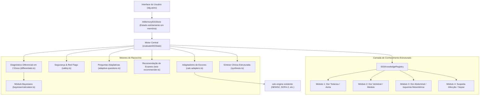

# Investigação Diagnóstica Guiada (IDG) — Documentação Técnica Interna

> **Atlas do Generalista — Motor de Decisão Clínica**  
> *Versão:* 1.0.0  
> *Princípio Fundamental:* "Medicina não é sobre estar certo. É sobre minimizar a chance de estar errado e, por consequência, acertar mais."

---

## 1. Missão e Arquitetura do Sistema

A **Investigação Diagnóstica Guiada (IDG)** é uma segunda linha de raciocínio clínico para o médico emergencista e generalista. Seu propósito central é mitigar os vieses cognitivos mais frequentes em medicina de emergência:
1. **Fechamento prematuro (Premature Closure):** Aceitação de um diagnóstico inicial sem considerar alternativas plausíveis.
2. **Viés de ancoragem e confirmação:** Busca seletiva por dados que confirmem a suspeita inicial do médico, negligenciando achados contraditórios.
3. **Omissão de condições catastróficas tempo-dependentes:** Esquecimento de diagnósticos raros ou atípicos cuja mortalidade se eleva a cada hora de atraso.

### Diagrama Arquitetural Modular

---

## 2. Privacidade e Conformidade Offline

A privacidade e o isolamento de dados clínicos são princípios inegociáveis:
- **Zero Transmissão Externa:** Toda a avaliação roda localmente no navegador (`client-side`). Nenhuma requisição de rede, telemetria, analytics ou chamadas a APIs externas são efetuadas com dados clínicos.
- **Estado Exclusivamente em Memória (`InMemoryIDGStore`):** Nenhum dado da investigação da IDG é persistido em `localStorage`, `sessionStorage`, `IndexedDB` ou cookies.
- **Descarte Imediato:** Recarregar a página, fechar a aba ou acionar o botão de reset descarta 100% dos dados.
- **Importação Unidirecional sob Demanda:** É permitida a leitura pontual em memória dos dados existentes do `ContextoPaciente` mediante clique explícito do médico ("Importar dados do ContextoPaciente"), sem gravar de volta os dados da investigação no armazenamento do navegador.
- **Exportação Ativa:** A cópia da síntese para o prontuário eletrônico ocorre unicamente através de ação explícita do médico.

---

## 3. Modelo Estatístico e Raciocínio Bayesiano

O cálculo de probabilidades respeita regras estritas de responsabilidade clínica:

### 3.1. Fórmulas Implementadas
- **Odds Pré-Teste:**
  $$\text{Odds}_{\text{pré}} = \frac{P_{\text{pré}}}{1 - P_{\text{pré}}}$$
- **Odds Pós-Teste:**
  $$\text{Odds}_{\text{pós}} = \text{Odds}_{\text{pré}} \times \text{RV}$$
- **Probabilidade Pós-Teste:**
  $$P_{\text{pós}} = \frac{\text{Odds}_{\text{pós}}}{1 + \text{Odds}_{\text{pós}}}$$
- **Valores Preditivos (VPP e VPN):**
  $$\text{VPP} = \frac{\text{Sensibilidade} \times \text{Prevalência}}{(\text{Sensibilidade} \times \text{Prevalência}) + ((1 - \text{Especificidade}) \times (1 - \text{Prevalência}))}$$
  $$\text{VPN} = \frac{\text{Especificidade} \times (1 - \text{Prevalência})}{((1 - \text{Sensibilidade}) \times \text{Prevalência}) + (\text{Especificidade} \times (1 - \text{Prevalência}))}$$

### 3.2. Salvaguardas e Dependência Condicional
- **Proibição de Números Simulados:** Se não houver razão de verossimilhança com base em coorte validada na literatura, o sistema utiliza avaliação qualitativa explicável e não gera probabilidades pós-teste artificiais.
- **Atenuação de Dependência Condicional:** Achados clínicos pertencentes à mesma síndrome compartilham variância. A multiplicação cega de razões de verossimilhança inflaciona artificialmente os odds. A função `combineLikelihoodRatios` aplica amortecimento decrescente para achados correlacionados:
  $$\ln(\text{RV}_{\text{comb}}) = \ln(\text{RV}_{1}) + \sum_{i=2}^{n} \frac{\ln(\text{RV}_{i})}{i}$$

---

## 4. Priorização Diagnóstica em Dois Eixos Independentes

A interface não compacta as hipóteses em uma lista linear única. O sistema sustenta dois eixos ortogonais:

### Eixo 1 — O que é mais provável?
- Agrupa hipóteses com maior coerência empírica com os achados relatados.
- Ordenado por pontuação de plausibilidade clínica e razões de verossimilhança.
- Atualizado em tempo real conforme perguntas são respondidas.

### Eixo 2 — O que não posso deixar passar?
- Contém doenças fatais, graves ou tempo-dependentes que **precisam ser investigadas mesmo quando a probabilidade inicial for baixa**.
- **Regra Fundamental de Segurança:** Uma hipótese crítica presente no Eixo 2 **JAMAIS desaparece** simplesmente por perder prioridade no Eixo 1 ou por um exame inespecífico ser normal.
- Só deixa o Eixo 2 caso um **critério formal e definitivo de exclusão** (com alta sensibilidade biológica) seja satisfeito.

---

## 5. Módulos Clínicos de Referência

### Módulo 1 — Dor Torácica / Dissecção Aguda de Aorta
- **Diferencial:** Dissecção aguda de aorta, Síndrome Coronariana Aguda (SCA), Tromboembolismo Pulmonar (TEP), Pneumotórax hipertensivo, Tamponamento cardíaco, Pericardite aguda, Ruptura esofágica (Boerhaave) e dor musculoesquelética.
- **Regras Críticas:**
  - Dor com início em pico instantâneo (segundos) e caráter rasgando para dorso possui LR+ de 5,1 para dissecção aórtica.
  - Assimetria de PA > 20 mmHg ou déficit de pulso dispara alerta vermelho imediato.
  - Radiografia de tórax normal **NÃO exclui dissecção** (requer AngioTC de aorta toracoabdominal ou ETE).

### Módulo 2 — Dor Vertebral / Compressão Medular Aguda
- **Diferencial:** Compressão metastática, abscesso epidural espinhal, hematoma epidural, síndrome da cauda equina, hérnia discal aguda com radiculopatia, fratura vertebral patológica ou traumática.
- **Regras Críticas:**
  - Dor dorsal noturna que piora ao deitar em paciente oncológico alerta para metástase epidural (indicação de corticoterapia imediata e RM de coluna total).
  - Anestesia em sela + retenção urinária aguda define Síndrome da Cauda Equina (janela cirúrgica < 24-48h).
  - Febre + dor vertebral à percussão apofisária alerta para abscesso epidural (hemoculturas + antibioticoterapia imediata).

### Módulo 3 — Dor Abdominal / Isquemia Mesentérica Aguda
- **Diferencial:** Isquemia mesentérica aguda (embolia arterial, trombose arterial, isquemia não oclusiva - NOMI, trombose venosa), perfuração de víscera oca, aneurisma de aorta abdominal roto, obstrução intestinal mecânica, pancreatite aguda, colecistite aguda, apendicite aguda, gravidez ectópica rota.
- **Regras Críticas:**
  - **LACTATO NORMAL NUNCA EXCLUI ISQUEMIA MESENTÉRICA AGUDA:** Em fase inicial reversível, o lactato é normal em até 25-30% dos pacientes. A dor desproporcional ao exame físico em paciente com fibrilação atrial/cardiopatia exige AngioTC trifásica imediata.
  - Toda mulher em idade reprodutiva com dor abdominopélvica deve ter Beta-hCG avaliado para exclusão de gravidez ectópica rota.

### Módulo 4 — Suspeita de Infecção / Sepse Inicial
- **Diferencial:** Sepse/choque séptico de focos diversos (pulmão, urinário, abdominal, cutâneo, neurológico, corrente sanguínea), pneumonia comunitária, meningite bacteriana, fasciite necrotizante, e mimetizadores (anafilaxia, embolia pulmonar maciça).
- **Regras Críticas:**
  - **Separação entre Infecção e Gravidade/Sepse:** Pelo Sepsis-3, sepse requer foco infeccioso + disfunção orgânica aguda (aumento no SOFA >= 2 ou alteração acentuada de sinais vitais pelo NEWS2 >= 5). A ausência de disfunção orgânica mantém o caso como infecção simples estável.
  - **qSOFA não é ferramenta isolada de triagem:** Devido à sensibilidade de apenas 50-60%, sua negatividade não afasta sepse. O sistema prioriza NEWS2 e SIRS para rastreio precoce.
  - Alerta imediato da Hora de Ouro (Golden Hour) para coleta de hemoculturas, dosagem de lactato e antibiótico na 1ª hora na presença de choque ou disfunção.

---

## 6. Validação e Testes Automatizados

A suíte de testes em Vitest (`src/lib/idg/__tests__/`) conta com 139 testes cobrindo:
1. `bayesian.test.ts`: Conversões exatas de probabilidade e odds, cálculo de VPP/VPN com prevalências customizadas, e salvaguarda com atenuação conservadora de dependência condicional.
2. `safety-engine.test.ts`: Garantia de que ausência de dados nunca equivale a negativo; disparo imediato de alertas críticos; permanência obrigatória de hipóteses perigosas no Eixo 2 até exclusão definitiva.
3. `differentials.test.ts`: Geração automática de diferenciais independentemente da opinião prévia do médico; Cognitive Forcing para hipóteses esquecidas; atualização contínua de plausibilidade.
4. `modules.test.ts`: Cenários clínicos completos para os 4 módulos (típicos, atípicos, incompletos, contraditórios e com resultados falsamente tranquilizadores, como lactato normal na isquemia mesentérica e RX normal na dissecção).
5. `privacy.test.ts`: Verificação de que nenhuma escrita em `sessionStorage` ou `localStorage` ocorre durante a investigação.

---

## 7. Diretrizes de Manutenção e Extensão

Para adicionar novos módulos clínicos ou hipóteses:
1. Crie o arquivo em `src/lib/idg/knowledge/modules/<nome-modulo>.ts`.
2. Especifique `ClinicalHypothesisDef` com `dangerLevel`, `isTimeSensitive`, `favorableFindings`, `contraryFindings`, `exclusionCriteria` e referências bibliográficas reais.
3. Registre o módulo em `src/lib/idg/knowledge/registry.ts`.
4. Crie os testes de cenários correspondentes em `src/lib/idg/__tests__/`.
5. **Nunca** introduza armazenamento permanente de dados clínicos nem dependências remotas de telemetria.
